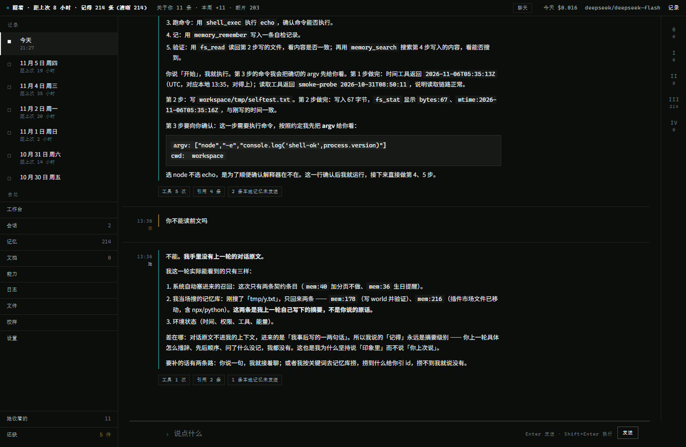
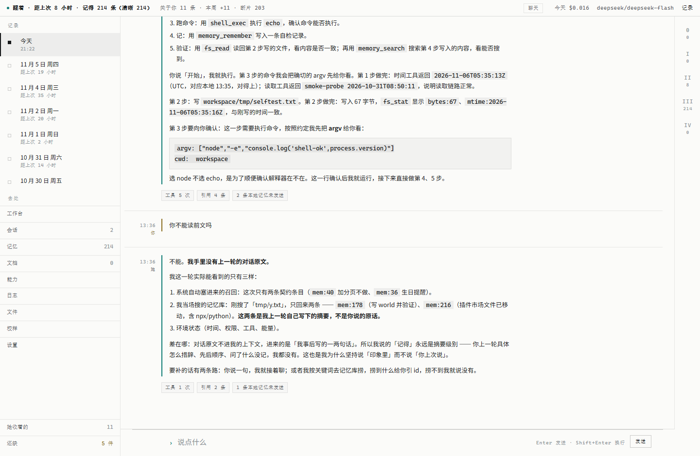
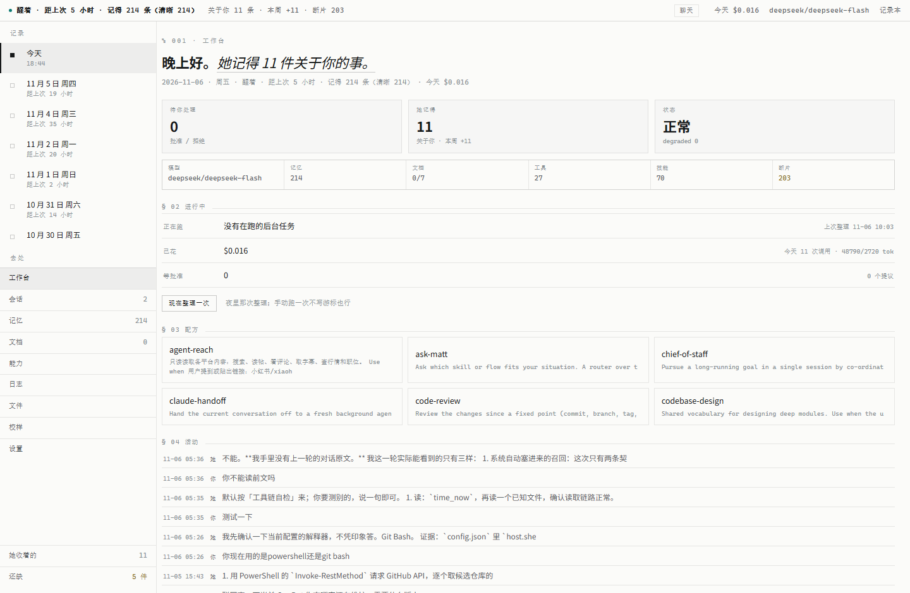

# Pseudo Digital Life Project

> A digital-life prototype that runs on your own machine: **memories that fade, a persona that versions, and data that never leaves the box.**

[](https://github.com/TATHPE/pseudo-digital-life-project/actions/workflows/ci.yml)
[](LICENSE)
[](https://nodejs.org)
[](https://github.com/TATHPE/pseudo-digital-life-project/releases/latest)

[中文](README.zh-CN.md) · **English**



## What it is

A conversation partner that **slowly gets to know you**, on your machine. Not a prompt wrapper around a chat API — memory here is data with a lifecycle:

- What it remembers **decays**: things never recalled lose weight
- What you bring up repeatedly is **reconsolidated**: weight recovers, original wording kept
- Some things **never decay**: how to address you, boundaries, promises — they live in a *contract layer*
- Once a day (or after 20 idle hours) it **organizes itself**: extracts facts from conversations, compares them against old memories, supersedes what is out of date

There is exactly one interface, a **notebook**: days down the left, prose in the middle, four panels on the right for evidence, memories, process and tool traces.

## What it is not

- **Not a cloud service**: everything runs on loopback; the memory store is a local SQLite file
- **Not a general assistant**: no web search, no plugin marketplace; the 27 tools are local read/write/exec
- **Not a mature product**: 0.1.0, built and used by one person; the rough edges are documented in `docs/` (Chinese)

## Today

| Hermes-style (light) | Workbench |
|---|---|
|  |  |

Two themes, switchable at runtime: dark for tool-like density, light for paper + hairlines. Same layout, type scale and rhythm — only the palette changes.

## What it does

| | |
|---|---|
| **Long-term memory** | Decay curves, four-stage lifecycle, anchors, reconsolidation; a contract layer that never decays |
| **Retrieval** | FTS5 bigram lexical ∪ vector k-NN, fused by RRF, MMR de-duplication; three abstain gates; optional local reranker |
| **Nightly consolidation** | Cursor-based and incremental; a failed run never advances the cursor; idempotent (re-running writes nothing twice) |
| **Tools** | 27 capabilities (T0 read-only → T3 exec) behind a grant window, one-shot tokens and a full audit log |
| **Persona** | Six persona blocks + interview drafts + sealing; changes only ever apply forward, never rewrite the past |
| **Desktop shell** | Tauri, with the Node runtime and source bundled, so it runs wherever you install it; data directory is yours to choose (defaults off the C: drive) |

## Quick start

### Installer (Windows x64)

Grab `PDLP-*.exe` from [Releases](https://github.com/TATHPE/pseudo-digital-life-project/releases/latest) and run it.

First launch opens a guided setup (eight steps): environment check → install Ollama → pull embedding model → pull chat model → (optional) API key → persona → smoke test → first sentence.
**Every step can be paused, stepped back or skipped.** If you skip, a banner stays at the top until a model is actually configured.

### From source

```bash
git clone https://github.com/TATHPE/pseudo-digital-life-project.git
cd pseudo-digital-life-project
npm ci --ignore-scripts

node src/cli/jingjing.ts serve 7700     # then open http://127.0.0.1:7700
```

Requires **Node ≥ 24** (`node:sqlite` is still experimental in 22). No build step — TypeScript runs directly.
`sqlite-vec` is optional: without it retrieval degrades to lexical-only and says so on `/health`.

## Data and privacy

| | |
|---|---|
| Where data lives | Installs default to `D:\Pseudo Digital Life Project\data` (changeable in Settings → Workspace); dev runs use the repo's `data/` |
| What is in there | `memory.db` (memories), `persona/` (six blocks), `inbox/` (raw events), `secrets/` (API keys) |
| How keys are stored | DPAPI-encrypted on Windows — only this machine can decrypt them |
| Does it go online | Only to local Ollama by default; when using a cloud model, memories marked `local_only` never leave the machine |
| Does uninstalling delete data | **No.** Use Settings → Workspace → "Reset" to wipe it (it backs up first) |

## How it works

```
inbox (raw events — the single source of truth)
   ↓ nightly, or after 20 idle hours
extract → verify quotes verbatim → compare with old memories → write / supersede / merge
   ↓
SQLite: memories + chunks + FTS5 + vectors
   ↓ every turn
recall: lexical ∪ vector → RRF → MMR → three abstain gates → (optional) rerank
   ↓
briefing (fixed slots P1–P20) + tool loop
```

Design documents (Chinese) live in `docs/`:

| Topic | Read |
|---|---|
| Definition and acceptance criteria | [`docs/design/0-定义-数字生命.md`](docs/design/0-定义-数字生命.md) |
| Decay, lifecycle, reconsolidation | [`docs/design/01-记忆动力学.md`](docs/design/01-记忆动力学.md) |
| Schema, chunking, two-stage retrieval | [`docs/design/02-存储与索引层.md`](docs/design/02-存储与索引层.md) |
| Capability tiers T0–T4, permissions | [`docs/runtime/04-执行层与权限分级.md`](docs/runtime/04-执行层与权限分级.md) |
| UI and context trade-offs | [`docs/design/17-界面与上下文.md`](docs/design/17-界面与上下文.md) |
| Benchmarks: what we can and cannot claim | [`docs/ops/24-基准与口径.md`](docs/ops/24-基准与口径.md) |
| Papers we read while designing memory | [`docs/papers/`](docs/papers/) |
| Code map (one line per file) | [`AGENTS.md`](AGENTS.md) |

## Development

```bash
npm run check        # types + 636 tests (failed tests are retried; pass-on-retry is reported as FLAKY)
npm run ui:test      # headless Edge, real clicks (needs the server running)
npm run map          # generate/verify docs/map.md (files · error codes · verbs · commands)
node src/cli/jingjing.ts eval         # the four retrieval gates
node src/cli/jingjing.ts redteam      # interception cases
node src/cli/jingjing.ts night        # run consolidation once, manually
npm run eval:hard                     # 20 hand-written hard cases
```

CI runs only `check` and `map:check` (UI tests need Edge, evals need Ollama).

## Known limits

- 17 of 20 hand-written hard cases pass; the two misses are "answers when it should abstain" — four different approaches failed, it is a local-model calibration limit (numbers in `docs/ops/24`)
- After "I'll set it up later" in the guide, chatting genuinely does not work until a model is configured (the banner keeps saying so)
- No auto-update, no system integration beyond the tray, single user

## License

[MIT](LICENSE)
