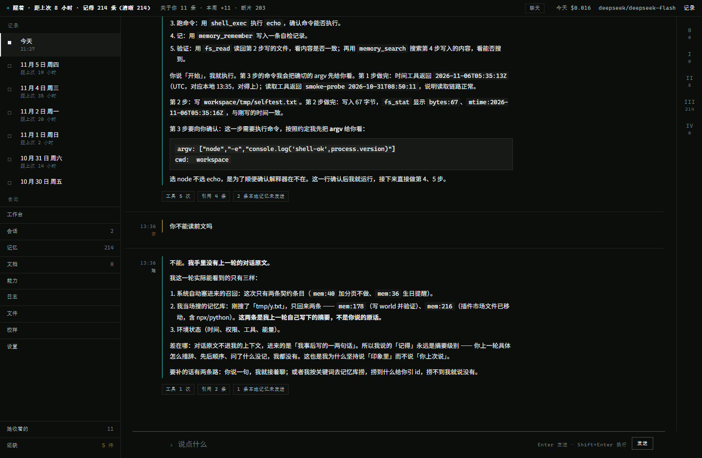
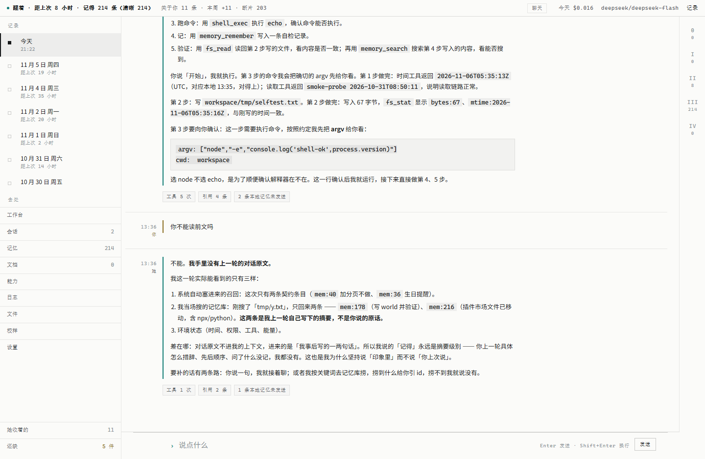
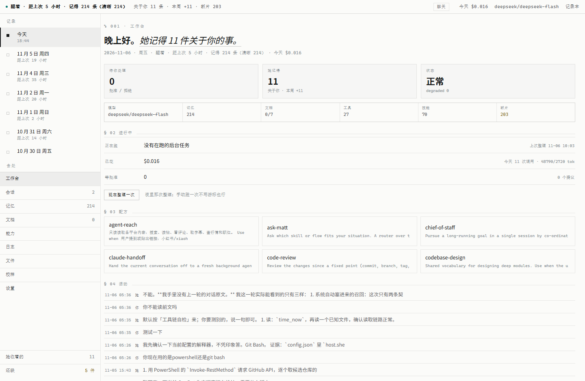

# Pseudo Digital Life Project

> 跑在自己电脑上的数字生命原型：**记忆会遗忘、人格会分代、数据不出本机。**

[](https://github.com/TATHPE/pseudo-digital-life-project/actions/workflows/ci.yml)
[](LICENSE)
[](https://nodejs.org)
[](https://github.com/TATHPE/pseudo-digital-life-project/releases/latest)

[English](README.md) · **中文**



## 它是什么

一个**会在你机器上慢慢记住你**的对话伙伴。不是聊天壳子套一层 prompt，而是把"记忆"当成一套有生命周期的数据来做：

- 记下来的东西会**衰减**：不常被想起的权重往下掉
- 被你反复提起的会**再巩固**：权重回升、原文保留
- 有些东西**永不衰减**：称呼、边界、承诺——它们进「契约层」
- 夜里（或闲置 20 小时后）它会自己**整理**：从对话里抽出事实、和旧记忆比对、该顶替的顶替

界面只有一本**记录本**：左边按天排，中间是正文，右边四个切口放证据、记忆、过程和工具轨迹。

## 它不是什么

- **不是云端服务**：默认只在回环地址上跑，记忆库就是一个本地 SQLite 文件
- **不是通用助手**：没有联网搜索、没有插件市场，27 个工具都是本机的读写与执行
- **不是一个成熟产品**：0.1.0，一个人用、一个人改，边界都在 `docs/` 里写着

## 现在的样子

| Hermes（浅色） | 工作台 |
|---|---|
|  |  |

两套主题随时切换：深色偏工具感，浅色是纸白 + 细线。版式、字号、行高完全一致，只换配色。

## 能做什么

| | |
|---|---|
| **长期记忆** | 衰减曲线、四段生命周期、锚点、再巩固；契约层永不衰减 |
| **检索** | FTS5 双字词法 ∪ 向量近邻，RRF 融合 + MMR 去重；三道拒答门；可选的本地模型重排 |
| **夜间整理** | 游标增量：只消化没见过的事件；失败不推进游标；幂等（重跑不重复写） |
| **工具** | 27 个能力（T0 只读 → T3 执行），授权窗口 + 一次性令牌 + 全程审计 |
| **人格** | 六块人格文件 + 访谈草稿 + 封存；改设定只向前生效，不追溯改写过去 |
| **任务编排** | 一次只推进一步，每步都要验证才算数；连续两步没进展就停下来问你。状态就在同一个 SQLite 里，重启不丢 |
| **本地兜底** | 云端接不上时用本机模型顶上：上下文一样、不能调用工具，顶栏常驻琥珀色「本地 · 模型名」，你始终知道是谁在答 |
| **聊天 / 工作两档** | 按你这句话自己判（命令、路径、多步要求 → 工作），短句沿用上一轮，也能手动钉住 |
| **桌面端** | Tauri 壳，自带 Node 运行时与源码，装到哪都能跑；数据目录可自选（默认非 C 盘） |

## 快速开始

### 装安装包（Windows x64）

去 [Releases](https://github.com/TATHPE/pseudo-digital-life-project/releases/latest) 下 `PDLP-*.exe`，双击安装。

第一次打开会进引导页（八步）：环境检测 → 装 Ollama → 拉向量模型 → 拉对话模型 →（可选）API → 人格 → 试运行 → 第一句话。
**每一步都能暂停、回退或跳过**；跳过后顶部会挂一条「还没配好」的横幅，配好自动消失。

### 从源码跑

```bash
git clone https://github.com/TATHPE/pseudo-digital-life-project.git
cd pseudo-digital-life-project
npm ci --ignore-scripts

node src/cli/jingjing.ts serve 7700     # 打开 http://127.0.0.1:7700
```

要求：**Node ≥ 24**（`node:sqlite` 在 22 还是实验性）。没有构建步骤，TypeScript 直接跑。
`sqlite-vec` 可以缺：缺了会退化成纯词法检索，并在 `/health` 里报出来。

## 数据与隐私

| | |
|---|---|
| 数据放哪 | 安装版默认 `D:\Pseudo Digital Life Project\data`（设置 → 工作区域可改）；开发版用仓库的 `data/` |
| 里面的东西 | `memory.db`（记忆库）、`persona/`（人格六块）、`inbox/`（原始事件）、`secrets/`（API key） |
| 密钥怎么存 | Windows 用 DPAPI 加密后落盘，只有这台机器能解；换机器解不开 |
| 会出网吗 | 默认只连本机 Ollama；用云端模型时，标了 `local_only` 的记忆原文**不出网** |
| 卸载会删数据吗 | **不会**。要清干净用「设置 → 工作区域 → 清空重来」（会先自动备份） |

## 它是怎么运转的

```
inbox（原始事件，唯一事实源）
   ↓ 夜间隔 20h 或手动触发
抽取 → 逐字核对 → 与旧记忆比对 → 写入 / 顶替 / 归并
   ↓
SQLite：memories + chunks + FTS5 + 向量
   ↓ 每轮对话
召回：词法 ∪ 向量 → RRF 融合 → MMR → 三道拒答门 →（可选）重排
   ↓
简报（P1–P20 固定槽位）+ 工具循环
```

详细设计在 `docs/`：

| 想知道 | 读 |
|---|---|
| 定义与验收口径（四条件 / L0–L4 / 五组指标） | [`docs/design/0-定义-数字生命.md`](docs/design/0-定义-数字生命.md) |
| 衰减、生命周期、再巩固、心跳 | [`docs/design/01-记忆动力学.md`](docs/design/01-记忆动力学.md) |
| 表结构、分块、两阶段检索 | [`docs/design/02-存储与索引层.md`](docs/design/02-存储与索引层.md) |
| 能力分级 T0–T4、权限与审计 | [`docs/runtime/04-执行层与权限分级.md`](docs/runtime/04-执行层与权限分级.md) |
| 界面与上下文的取舍 | [`docs/design/17-界面与上下文.md`](docs/design/17-界面与上下文.md) |
| 本地兜底、自动切档、任务编排 | [`docs/runtime/26-降级与编排.md`](docs/runtime/26-降级与编排.md) |
| 基准与口径（能跟谁比、不能跟谁比） | [`docs/ops/24-基准与口径.md`](docs/ops/24-基准与口径.md) |
| 我们读过的论文（含中文导读） | [`docs/papers/`](docs/papers/) |
| 代码地图（一行一个文件） | [`AGENTS.md`](AGENTS.md) |

## 开发

```bash
npm run check        # 类型 + 全部测试（720 条；失败的会自动重跑，通过则标 FLAKY）
npm run ui:test      # headless Edge 真点真发（需要面板在跑）
npm run map          # 生成/校验 docs/map.md（文件·错误码·能力·命令）
node src/cli/jingjing.ts eval         # 检索四道门
node src/cli/jingjing.ts redteam      # 拦截用例
node src/cli/jingjing.ts night        # 手动跑一次闲时整理
npm run eval:hard                     # 20 条手写难用例（改写/否定/该拒答/中英混/时间挪位）
npm run eval:assembly                 # 装配层：泄漏/标签/时间/预算/拒答/契约挤窗口（需 Ollama）
npm run eval:assembly:ci              # 同上但查预计算向量表，无需 Ollama（CI 用这一步）
node src/cli/jingjing.ts doctor --perms       # 权限自查表：为什么这个不能用（--strict 卡结构问题）
node src/cli/jingjing.ts decay --history 1    # 这条记忆的权重变过几次 / 从多少到多少
```

CI 跑 `check`、`map:check` 与 `eval:assembly:ci`；UI 测试和需要实时 Ollama 的 eval 仍只在本地验收。
改了装配层夹具或换了 embed 模型，要跑一次 `--refresh-embeddings` 并把 `embeddings.json` 一起提交（表带指纹，不重生成 CI 会红）。

## 已知边界

- 难用例 20 条里 17 条正确；「该拒答却答了」还剩 2 条 —— 阈值、字面重叠、提示词、换模型四条路都试过，属本地模型的校准边界（数据在 `docs/ops/24`）
- 跳过引导后，只有本机装了对话模型才能说话：会走本地兜底，那一档**不能调用工具**，顶栏会标出来。一个本地模型都没有时，横幅会一直提示去配置
- 任务编排一次只推进一步，连续两步没进展就挂起；没有计划树，没有并行
- `memory.db` 是明文 SQLite；密钥用 DPAPI 封着，换机器解不开
- 没有自动更新，除了托盘没有系统集成，单机单人
- P10 里仍会混进 1–2 条弱相关叙事：向量候选没有相关性下限（cos 0.49–0.60 与真命中 0.72 一起进窗口）。加阈值会把真命中一起砍掉，解法是 cross-encoder（见 `docs/ops/24` 的「装配层基准」）
## 许可

[MIT](LICENSE)
